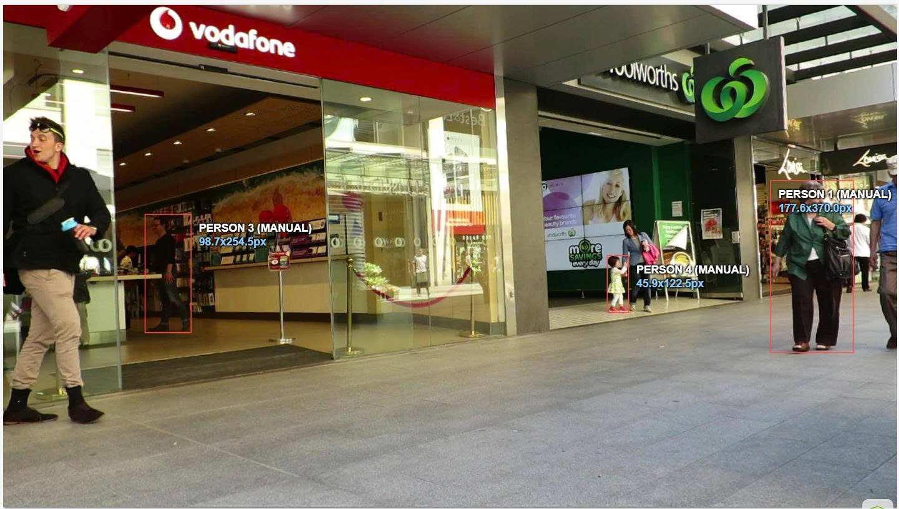
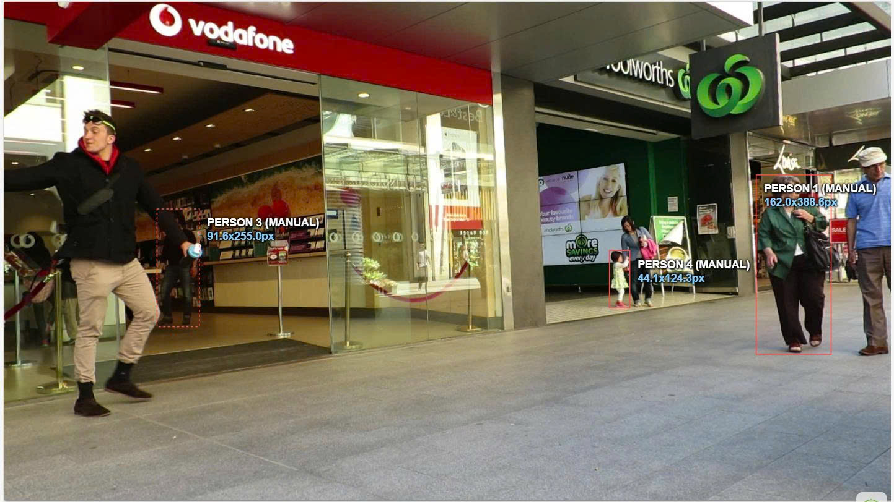
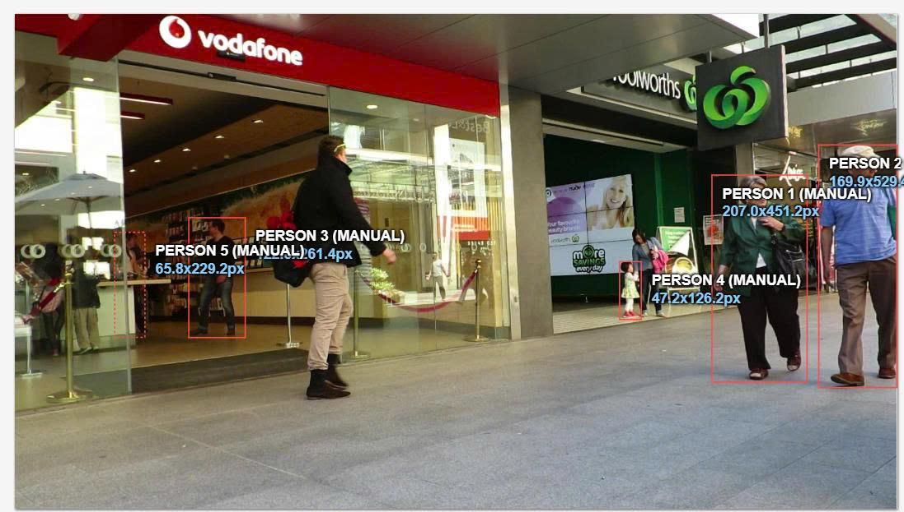

# Báo cáo cá nhân — PhanLeHoangPhuc-2A202603180

Đổi tên file theo quy tắc `MSSV_HoTen.md`. Ví dụ: `20241234_NguyenVanAn.md`.

Đoạn video: MOT17-09, 150 frame (frame 1–150), nguồn MOTChallenge, giấy phép CC BY-NC-SA 3.0.

## 0. Thông tin học viên

- Họ tên: Phan Lê Hoàng Phúc
- MSSV: 2A202603180
- Mã đề (A/B/C): A
- Email: phuchoang.path@gmail.com
- Link repository: https://github.com/phuchoangpath/K5-L2-DAY05-PhanLeHoangPhuc-2A202603180-MOTTracking
- Giờ bắt đầu: 16:45
- Giờ kết thúc: 18:30

## 1. Xem trước đoạn video (CP0)

Ghi **trước khi vẽ**, mỗi người một dòng.

| Mã | Frame xuất hiện | Frame cuối thấy được | Rẽ / dừng / đổi tốc độ ở frame | Bị che ở frame | Ghi chú |
|---|---|---|---|---|---|
| P1 | 1 | 149 | 20 (bắt đầu quay), 50(dừng lại chào) | 27–54 (khuất hẳn 38–47) | Đi trong shop, bị người đi ngoài che |
| P2 | 61 | 149 | 105 - 125 đổi hướng | 61–67 (che một phần) | Xuất hiện từ frame 61 ở lề trái trong cửa hàng |
| P3 | 0 | 149 | Phụ nữ lớn tuổi đi thẳng đều | Không | Đi thẳng đều bên phải vỉa hè, hướng lại gần camera |
| P4 | 40 | 149 | Đi thẳng đều | Không | Người đàn ông lớn tuổi Xuất hiện từ frame 40 ở góc trên bên phải |
| P5 | 0 | 148 | dừng 35 - 144 | 107 - 147 (có vài frame giữa thấy toàn bộ) | Em bé đi trong cửa hàng ra |

## 2. Keyframe và thời gian (CP1, CP4)

Số keyframe lấy từ kết quả `src/check_submission.py`.

| Mã | Số keyframe | Keyframe ở frame | Số frame có mặt | Keyframe / 100 frame | Thời gian (phút) | Chỗ khó |
|---|---|---|---|---|---|---|
| P1 | 24 | 1, 11, 15, 20, 21, 27, 31, 35, 47, 50, 51, 52, 54, 55, 69, 79, 89, 90, 99, 109, 119, 129, 139, 149 | 140 | 17.1 | 25 | Đoạn bị che khuất ở frame 27–54, cần cắm keyframe dày quanh đoạn che để ước lượng amodal box |
| P2 | 14 | 60, 67, 69, 70, 71, 73, 80, 90, 100, 110, 120, 130, 140, 149 | 90 | 15.6 | 15 | Xuất hiện muộn ở frame 60 từ mép trái, bị che một phần lúc mới vào (frame 61–67) |
| P3 | 16 | 0, 10, 20, 30, 40, 50, 60, 70, 80, 90, 100, 110, 120, 130, 140, 149 | 150 | 10.7 | 20 | Đi từ xa lại gần, kích thước tăng dần đều, cần kéo dãn box khớp cơ thể sau mỗi 10 frame |
| P4 | 12 | 40, 50, 60, 70, 80, 90, 100, 110, 120, 130, 140, 149 | 110 | 10.9 | 15 | Kích thước ban đầu nhỏ ở frame 40, dễ lẫn với hậu cảnh phía xa |
| P5 | 21 | 0, 2, 12, 22, 32, 42, 52, 62, 72, 82, 92, 102, 106, 107, 136, 137, 139, 141, 142, 143, 146 | 121 | 17.4 | 20 | Bị che tạm thời ở frame 107 - 147 (có vài frame giữa thấy toàn bộ) |
| **Tổng** | 87 | - | 611 | 14.2 | 95 | - |

Keyframe / 100 frame của cả bài = tổng keyframe ÷ tổng số frame có mặt × 100 = 87 ÷ 611 × 100 = **14.2**

Bạn đặt keyframe nhiều nhất ở người nào? Vì sao (người đó rẽ, dừng, lại gần camera hay bị che)?

Mình đặt keyframe nhiều nhất ở **P1 (24 keyframe)**. Lý do là P1 đi bên trong cửa hàng Vodafone và gặp tình huống bị người đi ngoài che khuất từ frame 27 đến frame 54 (khuất hẳn từ frame 38 đến 46). Mình cần cắm keyframe dày quanh đoạn này để ước lượng amodal box toàn thân, tránh trôi lệch và đảm bảo bật đúng cờ `occluded` / `outside`.

## 3. Đoạn bị che (CP2)

Người bị che: `P1`

| Mốc | Frame |
|---|---:|
| Bắt đầu bị che một phần (bật `occluded`) | 27 |
| Mất hẳn (bật `outside`) | 38 |
| Hiện lại (tắt `outside`) | 47 |
| Thấy rõ trở lại (tắt `occluded`) | 55 |

- Thời gian khuất hẳn: 9 frame = 0.30 giây.
- Quyết định: giữ cùng ID.
- Lý do (trả lời 3 câu: khuất bao lâu so với 60 frame, ngoại hình có khớp, chỗ hiện lại có đúng hướng và tốc độ):

1. **Thời gian khuất so với ngưỡng 60 frame (2 giây):** Đối tượng P1 chỉ bị khuất hoàn toàn trong 9 frame (tương đương 0.30 giây ở 30 fps), ngắn hơn rất nhiều so với ngưỡng 60 frame (2.0 giây) quy định của lớp.
2. **Độ khớp về ngoại hình:** Người xuất hiện trở lại hoàn toàn trùng khớp với P1 trước khi bị che (nam giới mặc áo len đen dài tay, quần tối màu, dáng người và chiều cao không đổi).
3. **Hướng đi và vận tốc:** Vị trí tái xuất hiện ở frame 47 nằm ngay sau quầy/cửa kính bên trong shop Vodafone, hoàn toàn ăn khớp với quỹ đạo bước đi từ trái sang phải với tốc độ ổn định ban đầu.

Do đó, việc giữ nguyên cùng một Track ID xuyên suốt đoạn che là hoàn toàn chính xác theo chuẩn MOT, đảm bảo không gây ra lỗi `id_switch` hay `fragmentation`.

Ảnh chụp màn hình:

## 4. Tự review ID (CP3)

Lượt 1 theo người (đi ngược từ frame 149 về 0 trên CVAT), lượt 2 theo cảnh (nhảy 10 frame). Ít nhất 3 dòng; không có lỗi thì ghi một dòng "đã kiểm hai lượt, không lỗi".

Loại lỗi dùng đúng một trong 7 mã: `id_switch`, `fragmentation`, `lost`, `merge`, `false_track`, `drift`, `flag`.

| Frame | Mã người | Loại lỗi | Mô tả một câu | Phát hiện ở lượt | Đã sửa? |
|---:|---|---|---|---|---|
| 31 | P1 | drift | Box nội suy bị trôi lệch khỏi thân người khi P2 đi sát qua che khuất | Lượt 1 (theo người) | Rồi |
| 51–53 | P1 | flag | Thừa cờ outside làm đoạn che bị đứt quãng thành 2 lần không đúng thực tế | Lượt 1 (theo người) | Rồi |
| 147–149 | P5 | lost | P5 đã đi ra khỏi khung hình ở frame 146 nhưng box vẫn trôi tiếp 3 frame | Lượt 2 (theo cảnh) | Rồi |
| 60 | P3 | drift | Đáy box bị hụt phần chân khi người sải bước dài giữa hai keyframe | Lượt 1 (theo người) | Rồi |

Tổng hợp số lỗi theo loại:

| `id_switch` | `fragmentation` | `lost` | `merge` | `false_track` | `drift` | `flag` |
|---:|---:|---:|---:|---:|---:|---:|
| 0 | 0 | 1 | 0 | 0 | 2 | 1 |

Lỗi nào chỉ lượt 2 (theo cảnh) mới thấy, lượt 1 (theo người) không thấy? Vì sao?

Lỗi kết thúc track muộn ở frame **147–149 của P5 (loại `lost`)**.

**Vì sao:**
- **Lượt 1 (tua ngược theo người):** Mình chỉ tập trung căn độ khít của box theo thân người P5, nên dễ bị cuốn theo quán tính di chuyển mà không nhận ra người đã hoàn toàn ra khỏi mép ảnh.
- **Lượt 2 (xem cảnh nhảy 10 frame):** Quan sát đồng thời cả 5 box giúp mình dễ phát hiện chiếc box trống nằm đơn độc ở mép ảnh khi người đã đi hẳn, từ đó kịp thời bật cờ `outside` tại frame 147 để đóng track đúng lúc.

## 5. File xuất và kết quả tự kiểm (CP4)

| Kiểm tra | Kết quả |
|---|---|
| Tên file MOT 1.1 | PhanLeHoangPhuc_mot.zip |
| Tên file CVAT for video 1.1 | PhanLeHoangPhuc_cvat_video.zip |
| Số track ID khác nhau trong `gt/gt.txt` (phải là 5) | 5 |
| Frame `outside` không có dòng trong `gt.txt` (đúng / sai) | đúng |
| Job đã completed trên CVAT máy cá nhân | đã completed |

Dán phần tóm tắt in ra từ `src/check_submission.py`:

Số frame in theo CVAT (bắt đầu từ 0). Trong gt.txt, frame_id = frame CVAT + 1.

=== File MOT 1.1: PhanLeHoangPhuc_mot.zip ===
  Số track ID: 5   |   Tổng số box: 611
  [OK]        Đúng 5 track ID.

  Track | Frame có mặt | Số frame | Đoạn vắng (outside)
      1 |   0–149      |      150 | -
      2 |   0–146      |      121 | 110–135
      3 |   1–149      |      140 | 38–46
      4 |  40–149      |      110 | -
      5 |  60–149      |       90 | -

=== File CVAT for video 1.1: PhanLeHoangPhuc_cvat_video.zip ===

  Track | Nhãn   | Frame thấy | Keyframe | KF/100 frame | Frame occluded | Lần bật outside
      0 | person |        150 |       16 |         10.7 |              0 |               0
              Track 0: keyframe ở frame [0, 10, 20, 30, 40, 50, 60, 70, 80, 90, 100, 110, 120, 130, 140, 149]
      1 | person |        110 |       12 |         10.9 |              0 |               0
              Track 1: keyframe ở frame [40, 50, 60, 70, 80, 90, 100, 110, 120, 130, 140, 149]
      2 | person |        140 |       24 |         17.1 |             19 |               1
              Track 2: keyframe ở frame [1, 11, 15, 20, 21, 27, 31, 35, 47, 50, 51, 52, 54, 55, 69, 79, 89, 90, 99, 109, 119, 129, 139, 149]
      3 | person |        121 |       21 |         17.4 |             13 |               2
              Track 3: keyframe ở frame [0, 2, 12, 22, 32, 42, 52, 62, 72, 82, 92, 102, 106, 107, 136, 137, 139, 141, 142, 143, 146]
      4 | person |         90 |       14 |         15.6 |              8 |               0
              Track 4: keyframe ở frame [60, 67, 69, 70, 71, 73, 80, 90, 100, 110, 120, 130, 140, 149]

  Tổng: 87 keyframe / 611 frame có mặt = 14.2 keyframe / 100 frame
  [OK]        Đọc được 5 track từ annotations.xml.

=== Tóm tắt ===
  Lỗi: 0   |   Cảnh báo: 0
  Đạt. Dán phần tóm tắt này vào báo cáo mục 5.

## 6. Ba câu kết

1. Nếu được gán lại, bạn sẽ đặt keyframe khác ở đâu? Vì sao?

   Nếu được gán lại, mình sẽ giảm bớt keyframe ở P3 (tăng bước nhảy từ 10 lên 15–20 frame) do người này đi thẳng đều với tốc độ ổn định, nội suy tuyến tính đã rất chính xác. Ngược lại, ở P1 quanh đoạn che khuất, mình sẽ cắm keyframe sát hơn trước mép bị che (frame 26 và 36) để box amodal bám sát chuyển động chân trước khi khuất hẳn.

2. Có chỗ nào bạn không chắc "cùng ID hay ID mới"? Bạn đã quyết định và ghi chú thế nào?

   Chỗ mình phân vân nhất là khi P1 xuất hiện lại ở frame 47 sau cửa kính shop Vodafone. Mình đối chiếu theo 3 câu hỏi quy tắc 60 frame: (1) Thời gian khuất 9 frame (< 60 frame); (2) Ngoại hình áo len đen và vóc dáng hoàn toàn khớp; (3) Hướng đi và tốc độ tiếp diễn đúng quán tính cũ. Do đó, mình quyết định giữ cùng Track ID cho P1 và tắt cờ `outside` ở frame 47 thay vì tạo track mới.

3. Một lỗi ID trong job của bạn (nếu không còn sót, chọn lỗi đã sửa) có thể làm xe tự lái dự đoán sai chuyển động của người đó như thế nào? Lỗi đó ảnh hưởng MOTA hay IDF1 nhiều hơn?

   - Nếu xảy ra lỗi đứt track (`fragmentation`) hoặc nhảy ID (`id_switch`) ở đoạn che khuất, hệ thống dự đoán quỹ đạo (trajectory prediction) của xe tự lái sẽ xem người đó là một vật thể mới xuất hiện đột ngột hoặc tính sai vận tốc tức thời, dễ dẫn đến phanh gấp nguy hiểm hoặc dự đoán sai hướng di chuyển.
   - Lỗi này ảnh hưởng đến **IDF1 nhiều hơn**. Vì MOTA chỉ phạt 1 điểm tại frame bị nhảy ID (`IDSW`), trong khi IDF1 đo lường sự nhất quán định danh trên toàn bộ quỹ đạo; khi track bị đứt đôi, toàn bộ các frame sau đó sẽ không còn được ghép đúng ID ban đầu, làm điểm IDF1 sụt giảm rất mạnh.

## Bonus (nếu làm)

### B1 — Hai người đi sát

...

### B2 — So cách đặt keyframe

| Cách đặt | Số keyframe | Frame trôi nhất | Ghi chú |
|---|---:|---:|---|
| Đều mỗi 30 frame | | | |
| Theo chỗ đổi hướng | | | |

...

### B3 — So với tracker có sẵn

| Frame | Mã người | Tracker làm gì | Nhãn của bạn | Giải thích (đoán rồi sửa / ghép IoU / box score thấp / ngoại hình) |
|---:|---|---|---|---|
| | | | | |
| | | | | |

## 7. Tài liệu tham khảo và công cụ AI đã dùng

- **Tài liệu tham khảo:** Benchmark MOT17 (Milan et al., 2016), tài liệu hướng dẫn Lab Day 05 (`docs/GUIDELINE.md`, `docs/MOT_FORMAT.md`, `lab_day05_walkthrough.md`).
- **Công cụ AI:** Trợ lý AI hỗ trợ kiểm tra định dạng file xuất, chạy script `check_submission.py`, và hỗ trợ rà soát câu chữ báo cáo.
